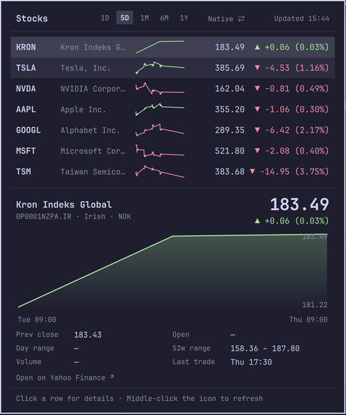

# Stocks for Omarchy

A chart icon in the Omarchy Quattro bar that opens a quotes panel: sparklines
per symbol, a detail chart with range selector, key stats and a currency
switch. Quotes and FX rates come from Yahoo Finance — no API key.



This repository is a fork of
[5d0tal1gat0r/omarchy-stocks](https://github.com/5d0tal1gat0r/omarchy-stocks)
that replaces the scrolling ticker tape with the icon, and adds a `labels`
setting plus a `longName` fallback so Yahoo's Morningstar-ID fund symbols still
show a readable name.

## Install

```sh
omarchy plugin add https://github.com/yamahaespen-dot/stockplugin.git --enable
```

The widget lands in the bar's center section. Move it with:

```sh
omarchy bar move io.github.5d0tal1gat0r.stocks --section right
```

## Usage

| where | action | effect |
|-------|--------|--------|
| icon | left click | open / close the panel (Esc closes, Tab switches panels) |
| icon | middle click | refresh now |
| panel | `1D 5D 1M 6M 1Y` | chart range (persisted) |
| panel | `USD ⇄` chip | left click: next currency · right click: previous · `Native` = each quote in its own currency |
| panel | click a row | show that symbol's chart and stats |
| panel | `Open on Yahoo Finance ↗` | open the selected symbol in your browser |

IPC (for keybindings): `omarchy-shell io.github.5d0tal1gat0r.stocks toggle|open|close|refresh`

## Configure

Settings live on the widget's entry in `~/.config/omarchy/shell.json` and apply
instantly:

```sh
omarchy bar set io.github.5d0tal1gat0r.stocks symbols '["AAPL","MSFT","BTC-USD","^GSPC"]' --json
omarchy bar set io.github.5d0tal1gat0r.stocks currency EUR
omarchy bar set io.github.5d0tal1gat0r.stocks labels '{"0P0001NZPA.IR":"KRON"}' --json
```

| key | default | meaning |
|-----|---------|---------|
| `symbols` | `["AAPL","NVDA","SPCX","GOOGL"]` | any Yahoo Finance symbols (stocks, ETFs, `BTC-USD`, `EURUSD=X`, `^GSPC`); a comma-separated string also works |
| `labels` | `{}` | short names for the panel rows and labels, keyed by symbol: `{"0P0001NZPA.IR":"KRON"}`. A `SYM=LABEL,...` string also works. Useful for mutual funds, which Yahoo only serves under Morningstar-ID symbols |
| `refreshMinutes` | `5` | quote refresh interval (minimum 1) |
| `chartRange` | `1d` | one of `1d 5d 1mo 6mo 1y` (the panel chips set this) |
| `currency` | `""` (native) | show every price in this currency, e.g. `EUR` (the panel chip sets this) |
| `currencies` | `["USD","EUR","GBP","JPY","CHF"]` | what the currency chip cycles through |
| `upColor` / `downColor` | theme `green` / `red` | the tints used for gains and losses, e.g. `"#a6e3a1"` |

Unknown symbols show as `Not Found` in the panel.

Mutual funds have no intraday series, so `1D` charts stay empty and `5D` is
sparse; use `1M` or longer. Yahoo serves some funds only under a Morningstar-ID
symbol (Kron Indeks Global is `0P0001NZPA.IR` in NOK) — pair those with a
`labels` entry so the panel stays readable.
Colors follow the current theme's `colors.toml`; themes without a `green` get a
neutral fallback.

## Develop

Clone this repository (or your fork), then from its root:

```sh
node --test test/model.test.js                              # Model.js unit tests
qmllint -I /usr/share/omarchy/shell Panel.qml BarWidget.qml
omarchy plugin validate "$PWD"
omarchy plugin add "$PWD" --enable                          # installs a clone into ~/.config/omarchy/plugins/
rsync -a --delete --exclude .git ./ ~/.config/omarchy/plugins/io.github.5d0tal1gat0r.stocks/
omarchy restart shell                                       # QML is cached per shell process; a restart loads the edit
qs log -p /usr/share/omarchy/shell --tail 100               # shell log
```

`Model.js` holds every piece of logic that does not need QML (parsing, formatting,
conversion, chart geometry) so it can be tested with plain Node.

## Remove

```sh
omarchy plugin remove io.github.5d0tal1gat0r.stocks
```

## License

MIT
